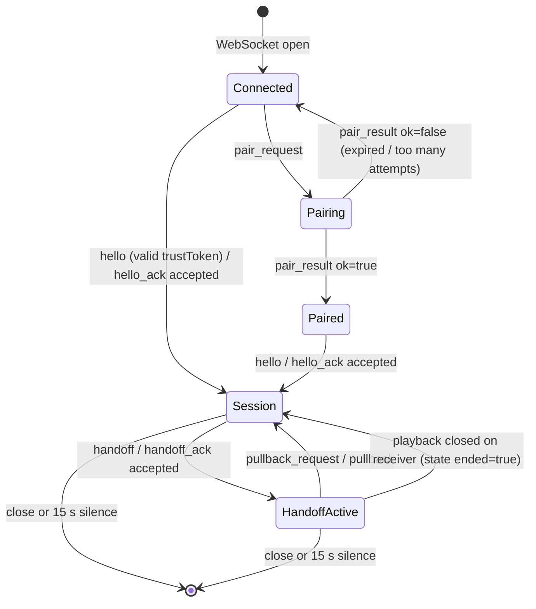
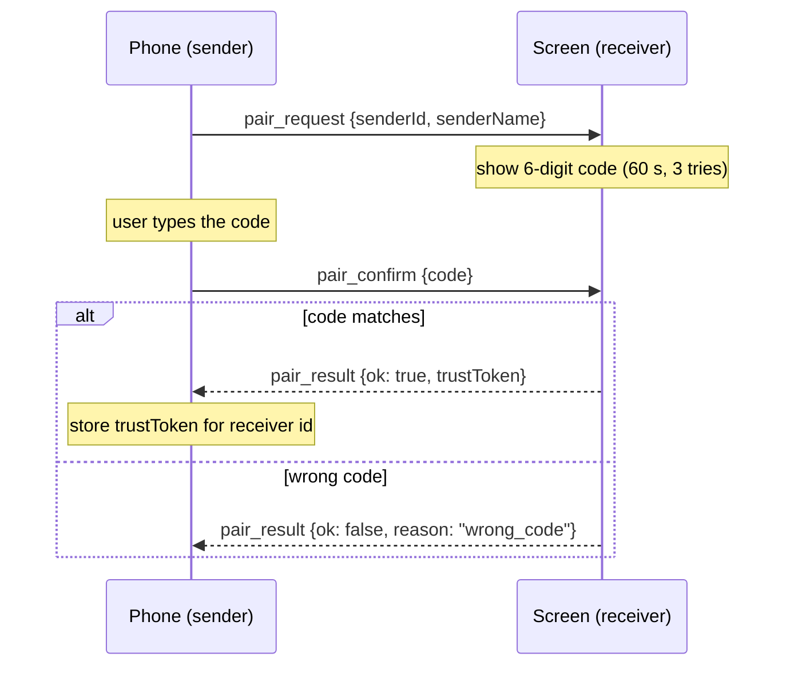
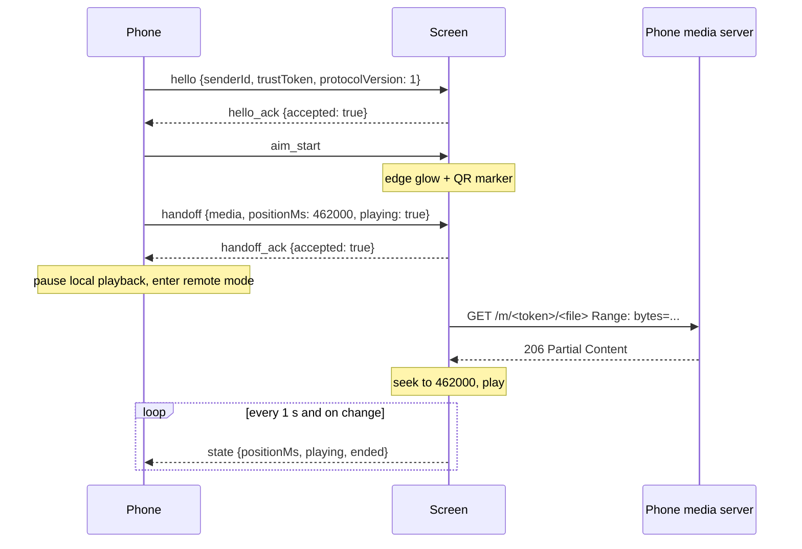
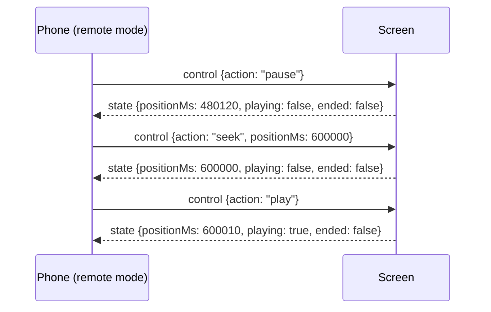
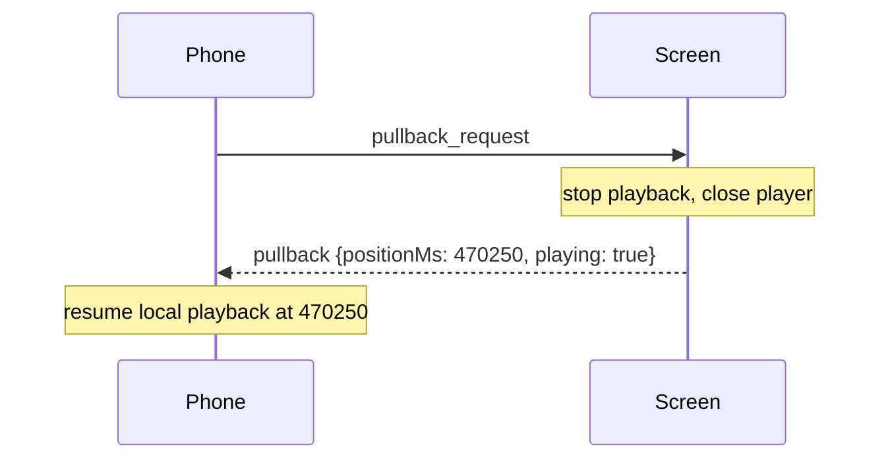

# SwipeTo Protocol v1

Status: **draft v1** · This document is the contract between every SwipeTo sender
(phone) and receiver (big screen). Any change to it must update, in the same
change, the JSON Schemas in [`schemas/`](schemas/), the test vectors in
[`test-vectors/`](test-vectors/), and every protocol library.

The key words MUST, MUST NOT, SHOULD and MAY are used as in RFC 2119.

## 1. Overview

SwipeTo is a **live handoff**, not screen mirroring. The phone tells a nearby
screen *what* to play and *from where*; the screen fetches the media itself and
plays it. The phone then acts as a remote, and can pull the media back.

| Role | Examples | Does |
|---|---|---|
| **Sender** | Android phone, iPhone | discovers receivers, pairs, aims, hands off, remote-controls, pulls back; serves its own media over local HTTP |
| **Receiver** | Windows PC, Samsung TV, Android TV, Mac | advertises itself, shows the pairing code, plays media, reports state |

Everything stays on the local network. Media MUST NOT be routed through any
cloud service.

## 2. Discovery (mDNS / DNS-SD)

Receivers advertise the service type **`_swipeto._tcp.local.`**. The instance
name SHOULD be the human-readable receiver name.

TXT record keys:

| Key | Value | Example |
|---|---|---|
| `id` | Stable receiver UUID (lowercase), generated once per install | `0e1d2c3b-4a59-4687-9a8b-7c6d5e4f3a21` |
| `name` | Display name, ≤ 64 UTF-8 bytes | `Living room PC` |
| `platform` | `windows` \| `tizen` \| `androidtv` \| `macos` | `windows` |
| `ver` | Highest protocol version spoken, decimal | `1` |
| `caps` | Comma-separated capabilities | `video,image` |
| `port` | WebSocket port, decimal (same as SRV port) | `48620` |

Senders MUST identify receivers by `id`, never by name or IP address: the IP
may change between sessions. Senders SHOULD ignore receivers whose `ver` does
not include a version they speak.

## 3. Transport

- WebSocket at **`ws://<host>:<port>/v1`**. One WebSocket = one session.
- Every message is a single UTF-8 **text** frame containing one JSON object.
  Binary frames MUST be answered with `error {code: "bad_message"}`.
- A frame larger than **64 KiB** MAY be rejected with `bad_message` and the
  connection closed.
- JSON field names are **camelCase**. Message `type` values are **snake_case**.

### 3.1 Envelope

Every message has these fields:

| Field | Type | Required | Meaning |
|---|---|---|---|
| `type` | string | yes | Message type (section 5) |
| `id` | UUID string | yes | Unique per message; senders SHOULD use UUID v4, lowercase |
| `ts` | integer | yes | Sender's clock, Unix milliseconds. Informational only — never used to compute playback position |
| `replyTo` | UUID string | no | On a response, the `id` of the message it answers |

v1 is **strict**: a message with a field that is not defined for its type is
invalid. Integers (`ts`, `positionMs`, `durationMs`) MUST be JSON integers, not
strings or fractions.

### 3.2 Invalid messages

On a message that does not parse, has an unknown `type`, or fails its schema,
the receiving side MUST reply `error {code: "bad_message"}` (with `replyTo` if
the `id` could be read) and MUST NOT change state. It MAY close the connection
after three consecutive bad messages.

## 4. Session state machine



Messages allowed in each state (anything else → `error`). A response is sent
in the state its request arrived in; the transition happens as the response is
sent and received, so `hello_ack` belongs to *Connected*/*Paired* and moves both
sides to *Session*.

| State | Sender may send | Receiver may send |
|---|---|---|
| Connected | `pair_request`, `hello` | `hello_ack` |
| Pairing | `pair_request`, `pair_confirm` | `pair_result` |
| Paired | `hello` | `hello_ack` |
| Session | `aim_start`, `aim_end`, `handoff` | `handoff_ack`, `state` |
| HandoffActive | `aim_start`, `aim_end`, `handoff`, `control`, `pullback_request` | `handoff_ack`, `state`, `pullback` |
| *any* | `ping`, `pong`, `error` | `ping`, `pong`, `error` |

`state` is allowed in *Session* so a final `state {ended: true}` that crosses a
`pullback_request` on the wire is not an error.

Transitions:

| Event | From → To |
|---|---|
| `pair_request` | Connected / Pairing / Paired → Pairing |
| `pair_result ok=true` | Pairing → Paired |
| `pair_result reason=code_expired / too_many_attempts` | Pairing → Connected |
| `pair_result reason=wrong_code` | stays in Pairing |
| `hello_ack accepted=true` | Connected / Paired → Session |
| `handoff_ack accepted=true` | Session / HandoffActive → HandoffActive |
| `pullback` | HandoffActive → Session |
| `state ended=true` | HandoffActive → Session |

A sender message that needs a session (e.g. `handoff`) received before a
successful `hello` MUST be answered with `error {code: "not_paired"}`.

## 5. Messages

Schemas for every message live in [`schemas/`](schemas/);
[`schemas/message.schema.json`](schemas/message.schema.json) validates any
message by dispatching on `type`.

### 5.1 Pairing (first time only)

| Message | Direction | Payload |
|---|---|---|
| `pair_request` | S → R | `senderId` (UUID, stable per phone install), `senderName` (1–64 chars) |
| `pair_confirm` | S → R | `code`: exactly 6 ASCII digits, as a string (leading zeros matter) |
| `pair_result` | R → S | `ok`; if `ok` then `trustToken`, else `reason` ∈ `wrong_code`, `code_expired`, `too_many_attempts`, `not_pairing` |

Receiver rules:

- On `pair_request` the receiver generates a uniformly random 6-digit code
  with a CSPRNG and shows it on screen. The code is valid for **60 s** and for
  **3** attempts. A new `pair_request` replaces any code in progress.
- `wrong_code` keeps the code valid (attempts permitting); `code_expired` and
  `too_many_attempts` end pairing and return to *Connected*. `pair_confirm`
  outside pairing gets `not_pairing`.
- `trustToken` is at least **128 bits** from a CSPRNG, encoded base64url without
  padding (22–128 chars). The receiver stores it against `senderId` and
  `senderName`; the sender stores it against the receiver `id`.
- Re-pairing an already-trusted `senderId` replaces its token.



### 5.2 Session

| Message | Direction | Payload |
|---|---|---|
| `hello` | S → R | `senderId`, `senderName`, `trustToken`, `protocolVersion` (integer ≥ 1) |
| `hello_ack` | R → S | `receiverId`, `accepted`; if not accepted, `reason` (error code) |

The receiver refuses with:

- `version_mismatch` if `protocolVersion` is not one it speaks (v1 receivers: `1`);
- `not_paired` if `trustToken` is unknown, revoked, or belongs to another `senderId`;
- `busy` if another sender currently has a handoff active and the receiver does
  not allow takeover (v1 receivers SHOULD allow only one active sender).

After a refused `hello_ack` the receiver MAY close the connection. Comparison
of trust tokens MUST be constant-time.

### 5.3 Targeting

| Message | Direction | Payload |
|---|---|---|
| `aim_start` | S → R | none |
| `aim_end` | S → R | none |

`aim_start` means the phone is raised and pointing at this receiver. The
receiver shows a thin glowing border around the screen edge and a **marker**: a
QR code encoding `swipeto:<receiverId>:<nonce>`, where `nonce` is fresh random
data the receiver rotates (Phase 4 defines rotation and verification).
`aim_end` hides both. A receiver MUST also hide them on `handoff`, on session
end, and after **10 s** without a new `aim_start`.

### 5.4 Handoff

| Message | Direction | Payload |
|---|---|---|
| `handoff` | S → R | `media`, `positionMs`, `playing` |
| `handoff_ack` | R → S | `accepted`; if not accepted, `reason` |

`media`:

| Field | Type | Required | Notes |
|---|---|---|---|
| `kind` | `video` \| `image` | yes | |
| `url` | `http://` or `https://` URL | yes | Max 2048 chars |
| `mime` | `video/*` or `image/*` | yes | e.g. `video/mp4` |
| `title` | string ≤ 200 | yes | May be empty |
| `durationMs` | integer ≥ 0 | no | Known duration, for the remote UI |

`positionMs` is where playback must continue (0 for images). `playing` says
whether to play or stay paused at that position.

The sender's media `url` has the form
`http://<phoneIp>:<port>/m/<sessionToken>/<fileId>`. The sender's media server:

- MUST support HTTP `Range` requests (`206 Partial Content`, `Accept-Ranges: bytes`);
- MUST serve only files explicitly handed off in the current session;
- MUST require `sessionToken` (≥ 128 bits, base64url) and answer `404` for any
  unknown token or file id — without revealing which part was wrong;
- MUST stop serving when the session ends.

Receiver rules: it replies `handoff_ack` **before** media starts loading, with
`unsupported_media` if it cannot play the `mime`/`kind`. A new `handoff` during
*HandoffActive* replaces the current media. If the media later fails to load,
the receiver sends `error {code: "unsupported_media"}` and returns to *Session*.



### 5.5 Remote control and state

| Message | Direction | Payload |
|---|---|---|
| `control` | S → R | `action` ∈ `play`, `pause`, `seek`, `stop`; `positionMs` required for `seek`, ignored otherwise |
| `state` | R → S | `positionMs`, `playing`, `ended` |

- `stop` ends playback on the receiver and closes the player; the receiver
  sends a final `state {ended: true}` and returns to *Session*.
- The receiver sends `state` **every 1 s** while *HandoffActive* and
  immediately after any change (play, pause, seek completed, ended, media
  closed by the user on the receiver).
- When the user closes playback on the receiver (Esc / close button), the
  receiver sends `state {ended: true, playing: false}` and returns to *Session*.
- `control` outside *HandoffActive* gets `error {code: "bad_message"}`.



### 5.6 Pull-back

| Message | Direction | Payload |
|---|---|---|
| `pullback_request` | S → R | none |
| `pullback` | R → S | `positionMs`, `playing` (state just before stopping) |

The receiver stops and closes playback, replies `pullback` (with `replyTo`), and
returns to *Session*. The sender resumes locally at `positionMs`, playing if
`playing`. `pullback_request` outside *HandoffActive* gets
`error {code: "bad_message"}`.



### 5.7 Keepalive

`ping` / `pong` carry no payload; `pong` sets `replyTo`. Each side sends `ping`
every **5 s** when it has sent nothing else in that time. Either side drops the
session after **15 s** without receiving any message. A receiver that drops a
session during *HandoffActive* keeps playing locally for the viewer but stops
sending state; a new session from the same sender MAY take it over with a new
`handoff`.

### 5.8 Errors

`error {code, message}`; `message` is human-readable (≤ 500 chars) and MUST
NOT contain secrets. Codes:

| Code | When |
|---|---|
| `unsupported_media` | Receiver cannot play the media kind/type, or it failed to load |
| `not_paired` | Session message before a successful `hello`, or bad trust token |
| `bad_message` | Unparseable, unknown type, schema violation, or wrong state |
| `busy` | Another sender holds the receiver |
| `version_mismatch` | Unsupported `protocolVersion` |

The same codes are used as `reason` in `hello_ack` and `handoff_ack`.

## 6. Security

- **Pair once.** A receiver accepts `hello` only with a trust token it issued.
  Tokens are revocable per sender from the receiver's settings.
- **Codes are short-lived.** 6 digits, 60 s, 3 attempts; a receiver SHOULD
  rate-limit `pair_request` to one per 5 s per connection.
- **Media is scoped.** The phone's media server serves only handed-off files,
  behind an unguessable per-session token, and stops with the session.
- **Local network only.** v1 uses plain `ws://` and `http://` on the LAN; the
  trust token protects session admission, not confidentiality. Transport
  encryption is a future-version item.
- Receivers MUST NOT log trust tokens, pairing codes, or full media URLs.

## 7. Versioning

`protocolVersion` in `hello` and `ver` in the TXT record are integers. A
breaking change bumps the version; adding fields is also a change to v1's
strict schemas and therefore requires updating schemas, vectors and every
library together (CLAUDE.md, ground rule 1).

## 8. Conformance

Every protocol library MUST:

1. parse and round-trip every file in `test-vectors/valid/` (re-serialized JSON
   is semantically equal to the input);
2. reject every file in `test-vectors/invalid/`.

Run the reference check with:

```
cd tools/validate-vectors && npm install && npm run validate
```
